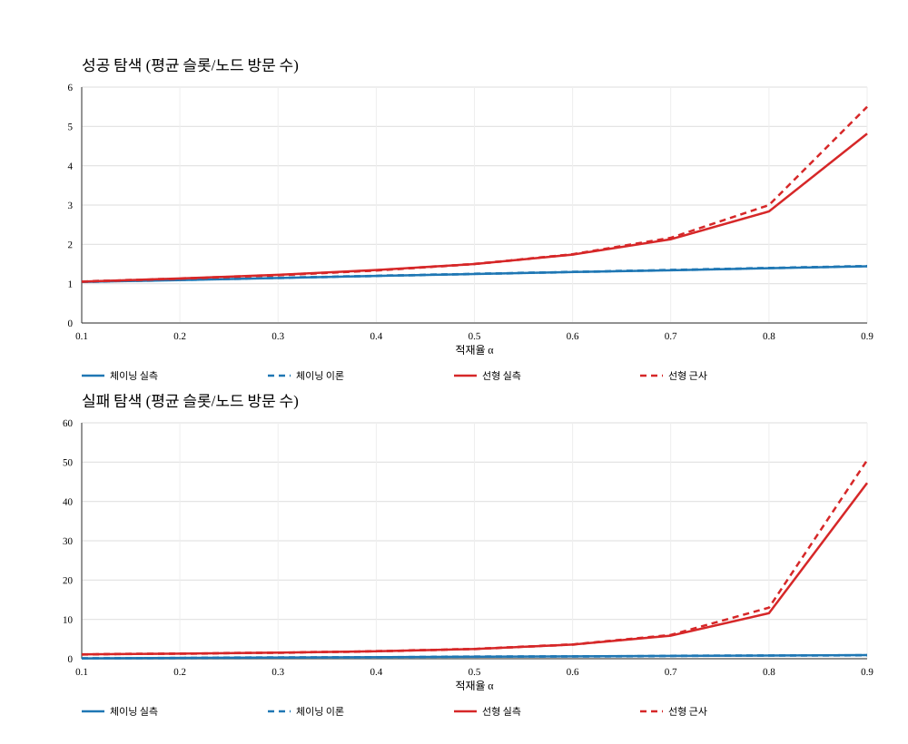

- **저장소:** https://github.com/kimnaeun0227/algorithms-hw2

# 해시 테이블 충돌 처리 방식별 탐색 비용 비교

- **과목:** 고급알고리즘 과제 2
- **주제:** 개별 체이닝과 선형 탐지의 평균 탐색 비용
- **참고:** [과제2 강의 자료](https://lec-algorithm.github.io/lecture/slides/hw2-2026/#57)

## 1. 구현 방식

개별 체이닝은 각 버킷에 `(URL, 코드)` 쌍의 연결 리스트를 두어 충돌한 항목을 같은 버킷에 저장한다. 선형 탐지는 충돌이 나면 다음 슬롯을 확인하고, 삭제 표식과 배열 끝에서 처음으로 돌아가는 순환 탐색으로 검색 체인을 보존한다. 두 방식은 모두 Horner 해시 `h = (31h + ord(c)) mod M`을 사용하며, 단축기는 같은 인터페이스로 URL→코드와 코드→URL을 저장한다.

## 2. 실험 목적

해시 충돌을 처리하는 두 방식인 개별 체이닝(separate chaining)과 선형 탐지(linear probing)가 적재율에 따라 탐색 비용을 어떻게 달리 보이는지 비교한다. 특히 저장된 키를 찾는 성공 탐색과 없는 키를 확인하는 실패 탐색을 따로 측정하고, 실측값을 이론식과 대조한다.

## 3. 실험 방법

두 테이블의 용량은 각각 10,000으로 고정했다. 난수 시드 2026으로 생성한 같은 키 집합과 실패 질의 집합을 사용하고, 적재율 `α = 저장된 키 수 / 용량`을 0.1부터 0.9까지 바꾸었다. 각 단계에서 성공 탐색은 저장된 키 전체를, 실패 탐색은 같은 부재 키 집합을 조회했다. 문자열 해시는 프로젝트에서 구현한 Horner 식을 사용했다.

한 번의 탐색에서 체이닝은 비교한 연결 노드 수를, 선형 탐지는 방문한 슬롯 수를 센다. 선형 탐지의 실패 탐색에서는 탐색을 끝내는 빈 슬롯도 방문 횟수에 포함한다.

비교 기준으로 사용한 기대값은 다음과 같다.

- 체이닝 성공: `1 + α/2`, 실패: `α`
- 선형 탐지 성공 근사: `½ × (1 + 1/(1−α))`
- 선형 탐지 실패 근사: `½ × (1 + 1/(1−α)²)`

## 4. 결과

표의 값은 **실측 / 이론 또는 근사값**이며, 단위는 탐색당 평균 노드 또는 슬롯 방문 횟수다.

| 적재율 α | 체이닝 성공 | 체이닝 실패 | 선형 탐지 성공 | 선형 탐지 실패 |
|---:|---:|---:|---:|---:|
| 0.1 | 1.045 / 1.050 | 0.101 / 0.100 | 1.053 / 1.056 | 1.117 / 1.117 |
| 0.2 | 1.093 / 1.100 | 0.203 / 0.200 | 1.132 / 1.125 | 1.304 / 1.281 |
| 0.3 | 1.144 / 1.150 | 0.299 / 0.300 | 1.226 / 1.214 | 1.555 / 1.520 |
| 0.4 | 1.198 / 1.200 | 0.401 / 0.400 | 1.348 / 1.333 | 1.899 / 1.889 |
| 0.5 | 1.246 / 1.250 | 0.501 / 0.500 | 1.499 / 1.500 | 2.471 / 2.500 |
| 0.6 | 1.296 / 1.300 | 0.609 / 0.600 | 1.739 / 1.750 | 3.594 / 3.625 |
| 0.7 | 1.340 / 1.350 | 0.711 / 0.700 | 2.129 / 2.167 | 5.858 / 6.056 |
| 0.8 | 1.393 / 1.400 | 0.815 / 0.800 | 2.838 / 3.000 | 11.588 / 13.000 |
| 0.9 | 1.443 / 1.450 | 0.913 / 0.900 | 4.817 / 5.500 | 44.704 / 50.500 |

## 5. 분석

적재율이 낮을 때 두 방식의 성공 탐색 비용은 모두 약 1회 방문에 가깝다. 체이닝 실측값은 적재율 0.1에서 0.9로 증가하는 동안 성공 탐색 1.045→1.443회, 실패 탐색 0.101→0.913회로 완만하게 증가했다. 전체 구간에서 체이닝 값은 기대값에 근접한다.

선형 탐지는 높은 적재율에서 비용이 더 가파르게 증가했다. 특히 적재율 0.9에서 실패 탐색은 평균 44.704개 슬롯을 방문했다. 같은 적재율의 체이닝 실패 탐색 0.913회와 비교하면 약 48.9배다. 선형 탐지에서는 충돌한 키가 다음 슬롯에 연속해서 놓일 수 있고, 이런 군집을 지나 빈 슬롯까지 확인해야 실패를 판정하기 때문이다. 성공 탐색도 적재율 0.9에서 4.817회로 증가했다.

실측값과 근사값 사이에는 차이가 있다. 적재율 0.9의 선형 탐지 실패 탐색은 근사값 50.500회보다 5.796회 적었다. 이론식은 이상적인 해시 분포를 가정한 기대값인 반면, 이번 측정은 시드가 고정된 하나의 유한한 키 집합에 대한 결과다. 따라서 이 차이를 오류로 보기보다는 입력 집합과 근사 가정의 차이로 해석해야 한다. 다른 시드와 여러 입력 집합을 반복 측정하면 결과의 변동 폭도 추가로 평가할 수 있다.

## 6. 결론과 과제 구현의 연결

이번 실험에서는 적재율이 낮을 때 두 방식의 탐색 비용이 비슷하지만, 적재율이 높아질수록 선형 탐지의 실패 탐색 비용이 빠르게 증가하는 것을 확인했다. 따라서 높은 적재율에서도 비교적 안정적인 탐색이 중요하면 체이닝이 유리하고, 선형 탐지를 사용할 때는 적재율을 낮게 유지하는 것이 중요하다.

웹 화면의 8칸 테이블과 시작 시 저장되는 충돌 예시 URL 3개는 충돌 처리 과정을 눈으로 확인하기 위한 데모다. 이는 용량 10,000으로 평균 비용을 측정한 본 실험과 목적이 다르며, 작은 데모의 측정값을 대규모 테이블의 성능 결과로 해석해서는 안 된다.

실험은 `make experiment`로 재현할 수 있다. 측정 표는 [probe_results.md](probe_results.md), 그래프는 [probe_results.svg](probe_results.svg)에 있다.

## 7. 에이전트 오류와 수정

초기 웹 테이블의 기본 용량을 1024로 두어 화면에 빈 슬롯 1023개가 보였다. 사용자가 화면에서 이를 확인해 지적했고, 기본 서버 용량을 8로 줄였다. 이어 같은 해시 슬롯 6에 놓이는 URL 3개를 시작 데이터로 넣고, 테이블이 8행이며 선형 탐지 방문 경로가 `6 → 7 → 0`인지 테스트와 실제 HTTP 응답으로 확인했다.

## 8. 느낀 점

이번 실험에서 가장 인상 깊었던 점은 적재율 0.9에서 선형 탐지의 실패 탐색이 평균 44.704회까지 늘어난 것이다. 같은 상황의 체이닝은 0.913회라서, 충돌 처리 방식이 조회 비용을 크게 바꾼다는 것을 알 수 있었다. 웹 테이블에서 충돌 URL의 방문 슬롯을 확인하니 군집이 생기는 과정이 더 잘 이해됐다. 다음에는 다른 키 집합에서도 실험해 결과가 얼마나 달라지는지 확인해 보고 싶다.
